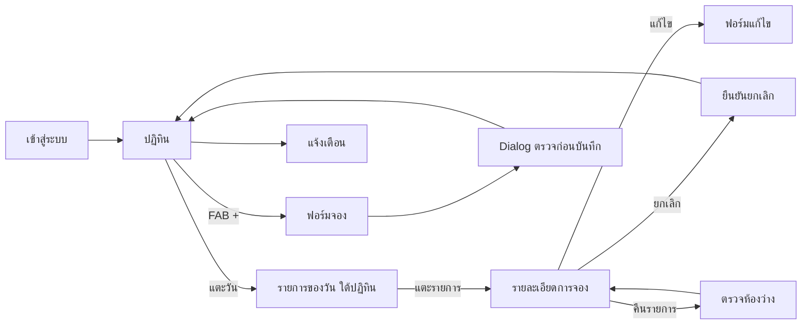

# Booking Share — UX/UI spec (MVP)

อ้างอิงจาก [SCOPE.md](./SCOPE.md) เป็นแหล่งความจริงของขอบเขตและกติกา เอกสารนี้กำหนดหน้าจอ การไหลของผู้ใช้ และ design tokens ก่อนเริ่มเขียนโค้ด

ดู wireframe แบบกดได้ที่ [wireframes/index.html](./wireframes/index.html) (เปิดในเบราว์เซอร์; ลิงก์ตรง `#calendar`, `#form`, `#detail`, `#notifications`, `#account`, `#rooms`)

## 1. หลักการออกแบบ

- **Mobile first:** ออกแบบที่ 375px ก่อน แล้วขยายเป็น tablet/desktop (จำกัดความกว้างเนื้อหา ~640px ตรงกลาง บน desktop)
- **ดูยอดได้ในไม่กี่วินาที:** เปิดแอปมาเห็นเดือนปัจจุบัน วันนี้ถูกเลือกไว้ และยอดของวันนั้นทันที
- **จองให้เสร็จด้วยนิ้วโป้ง:** ปุ่มหลักอยู่โซนล่างของจอ (FAB / sticky bottom bar)
- **ไม่ให้เข้าใจผิดเรื่องตัวเลข:** แยก "รายการจอง", "เช็กอิน", "กำลังพัก" ให้ชัด ใช้ป้ายกำกับเต็ม ไม่ใช้สีอย่างเดียว
- **ภาษาไทยเป็นหลัก:** รูปแบบวันที่ `จ. 6 ต.ค.` ปีใช้ **ค.ศ.** ทั้งแอป (เช่น `ตุลาคม 2026`) เขตเวลา `Asia/Bangkok`

## 2. Design tokens

> ชุดสีปรับจากผล `ui-ux-pro-max` (navy + gold accent) เฉพาะส่วนที่ตรงกับงานแอปภายใน ไม่ใช้สไตล์ Liquid Glass หรือฟอนต์ serif ที่ระบบแนะนำเพราะไม่เหมาะกับแอปเครื่องมือภายใน

### สี (semantic tokens)

| Token | Light | ใช้กับ |
| --- | --- | --- |
| `--color-primary` | `#1E3A8A` | ปุ่มหลัก วันที่เลือก ลิงก์ |
| `--color-on-primary` | `#FFFFFF` | ข้อความบนปุ่มหลัก |
| `--color-secondary` | `#3B82F6` | ไฮไลต์รอง / จุดบอกจำนวนบนปฏิทิน |
| `--color-accent` | `#A16207` | ตัวบอก "วันนี้" ยอดเงิน |
| `--color-background` | `#F8FAFC` | พื้นหลังหน้า |
| `--color-card` | `#FFFFFF` | การ์ด รายการ ชีต |
| `--color-foreground` | `#0F172A` | ข้อความหลัก (เข้มกว่าที่ระบบแนะนำเพื่อ contrast ≥ 4.5:1) |
| `--color-muted-foreground` | `#475569` | ข้อความรอง |
| `--color-muted` | `#E9EEF5` | พื้นชิป พื้นช่องว่าง |
| `--color-border` | `#BFDBFE` | เส้นขอบ |
| `--color-destructive` | `#DC2626` | ยกเลิกรายการ ข้อผิดพลาด |
| `--color-success` | `#15803D` | คืนรายการสำเร็จ / จองสำเร็จ |
| `--color-ring` | `#1E3A8A` | focus ring |

- **ธีมเดียว (light) เท่านั้น** ไม่มี dark mode ใน MVP แต่ยังใช้ semantic tokens ไม่ hardcode hex ในคอมโพเนนต์ เพื่อให้เพิ่มธีมได้ภายหลัง

### ตัวอักษร

- **IBM Plex Sans Thai** (Google Fonts, รองรับ subset `thai` + `latin`) น้ำหนัก 400 / 500 / 600 / 700
- ขนาด: body 16px (ขั้นต่ำสำหรับ input เพื่อกัน iOS zoom), caption 13–14px, หัวข้อหน้า 20–24px
- ตัวเลขยอดใช้ `font-variant-numeric: tabular-nums`

### Spacing / รูปทรง / ไอคอน

- ระยะห่างตามจังหวะ 4/8px (4, 8, 12, 16, 24, 32)
- มุมโค้ง: การ์ด 12px, ปุ่ม/ช่อง 10px, bottom sheet 20px (มุมบน)
- ไอคอน: **Phosphor** แบบ regular/ขนาดเดียวกันทั้งแอป (20 และ 24px) ห้ามใช้ emoji เป็นไอคอน
- Touch target ≥ 44×44px ทุกจุดที่กดได้

### Motion

- เบามาก 150–250ms ใช้กับ press feedback, เปิด/ปิด sheet, สลับเดือน
- เคารพ `prefers-reduced-motion` (ตัดแอนิเมชันที่ไม่จำเป็น)
- Press state ใช้สี/ความทึบ ห้ามเปลี่ยนขนาดจนเลย์เอาต์ขยับ

## 3. โครงสร้างการนำทาง

Bottom navigation 3 รายการ (ไม่เกิน 5) พร้อมไอคอนและป้ายข้อความ:

| แท็บ | เส้นทาง | หมายเหตุ |
| --- | --- | --- |
| ปฏิทิน | `/calendar` | หน้าแรก |
| การแจ้งเตือน | `/notifications` | มีจุดแดงบอกจำนวนที่ยังไม่อ่าน (ประกาศให้ screen reader ด้วย) |
| บัญชี | `/account` | ชื่อ อีเมล ออกจากระบบ |

ปุ่ม **+ จอง** แบบลอย (FAB) บนหน้าปฏิทิน อยู่เหนือ bottom nav ด้านขวา เปิด `/bookings/new` โดยตั้งวันเข้าเป็นวันที่ที่เลือกอยู่



## 4. หน้าจอ

### 4.1 เข้าสู่ระบบ `/login`

- โลโก้/ชื่อแอป, ช่องอีเมล, ช่องรหัสผ่าน (รองรับ password manager และ paste), ปุ่มเข้าสู่ระบบเต็มความกว้าง
- ข้อผิดพลาดแสดงใต้ช่อง และข้อความรวมด้านบนเมื่อล้มเหลว (เช่น "อีเมลหรือรหัสผ่านไม่ถูกต้อง")
- ผู้ที่ไม่อยู่ใน `team_members` เห็นข้อความ "บัญชีนี้ยังไม่ได้รับสิทธิ์ ติดต่อผู้ดูแล"

### 4.2 ปฏิทิน `/calendar` (หน้าหลัก)

```text
┌─────────────────────────────┐
│  ‹   ตุลาคม 2026   ›  วันนี้ │  ← หัวเดือน + ปุ่มกลับมาวันนี้
│ อา จ  อ  พ  พฤ ศ  ส          │
│  .  .  1  2  3  4  5         │  แต่ละช่อง: เลขวัน + ยอดเช็กอิน
│  6  7  8  9 10 11 12         │  วันที่เลือก = พื้น primary
│ ...                          │  วันนี้ = วงขอบ accent
├─────────────────────────────┤
│ จ. 6 ต.ค.                    │
│ ┌────────┬────────┬────────┐ │  สรุปของวันที่เลือก (3 ช่อง)
│ │ 3      │ 7 คน   │ 12 คน  │ │
│ │ รายการ │ เช็กอิน │ กำลังพัก│ │
│ └────────┴────────┴────────┘ │
│ ▸ รายการจอง                  │
│ ┌─────────────────────────┐ │
│ │ คุณสมชาย  ห้อง 101, 102   │ │  การ์ดรายการ
│ │ 6–8 ต.ค. (2 คืน) · 4 คน   │ │
│ │ ฿ 5,400                  │ │
│ └─────────────────────────┘ │
│                      [ + จอง]│  FAB
├─────────────────────────────┤
│  ปฏิทิน    แจ้งเตือน   บัญชี   │
└─────────────────────────────┘
```

**กติกา**
- เปิดครั้งแรกเลือก "วันนี้" อัตโนมัติ
- ช่องวันในปฏิทินแสดงเลขวันและตัวเลขเดียวที่อ่านง่าย (ยอดเช็กอิน) พร้อม `aria-label` เต็ม เช่น "6 ตุลาคม เช็กอิน 7 คน กำลังพัก 12 คน"; รายละเอียดทั้งสามค่าดูในแถบสรุปใต้ปฏิทิน เพื่อไม่ให้ช่องแน่นบน 375px
- ช่องวันที่ไม่มีการจองแสดงเลขวันอย่างเดียว
- สลับเดือนด้วยปุ่ม ‹ › (ต้องมีปุ่มเสมอ; swipe เป็นทางเลือกเสริม ไม่ใช่ทางเดียว)
- แถบสรุป 3 ค่า: **รายการจอง** (จำนวนรายการ), **เช็กอิน** (คนที่เข้าวันนั้น), **กำลังพัก** (`check_in <= วัน < check_out`) แยกชัดและติดป้ายข้อความ
- รายการจองของวันที่เลือก: ครอบคลุมทั้งรายการที่เช็กอินและกำลังพักวันนั้น ใส่ป้าย "เช็กอินวันนี้" / "กำลังพัก"
- ยอดเงินแสดงในการ์ดและหน้ารายละเอียด ไม่ใช่ในช่องปฏิทิน
- สถานะว่าง: "ยังไม่มีการจองในวันนี้" พร้อมปุ่ม "เพิ่มการจอง"
- สถานะโหลด: skeleton ของปฏิทินและรายการ (จองพื้นที่เพื่อไม่ให้เลย์เอาต์กระโดด)
- รายการยกเลิกแล้วไม่นับยอด และซ่อนจากรายการเริ่มต้น (มีตัวสลับ "แสดงที่ยกเลิก")

### 4.3 ฟอร์มจอง `/bookings/new` และแก้ไข `/bookings/[id]/edit`

หน้าเดียวเลื่อนลงเป็นส่วน ๆ (ไม่แยกหลายขั้นเพราะจองไม่ซับซ้อน) ปุ่มบันทึกติดล่างจอ

1. **วันพัก**
   - วันเข้า / วันออก (date input ที่เหมาะกับมือถือ) แสดงสรุป "2 คืน" อัตโนมัติ
   - วันออกต้องหลังวันเข้าอย่างน้อย 1 วัน ตรวจแบบ inline
2. **ห้อง** (เลือกได้หลายห้อง)
   - รายการห้องเป็นแถวที่แตะเลือกได้ แสดงชื่อห้องและ **ราคาอ้างอิงต่อคืน** (ตัวเลขเดียว เช่น "฿1,200/คืน") เป็นข้อมูลประกอบการกรอกยอดรวมเท่านั้น ไม่นำไปคำนวณ พร้อมสถานะ "ว่าง" / "ไม่ว่างในช่วงนี้" คำนวณจากวันที่เลือก ห้องที่ไม่ว่างปิดการเลือกและบอกเหตุผลเป็นข้อความ (ไม่ใช้สีอย่างเดียว)
   - ห้องที่เลือกแล้วแสดงช่อง **จำนวนคน** แยกต่อห้อง (stepper − / + กับช่องตัวเลข `inputmode="numeric"` ขั้นต่ำ 1)
   - สรุป: "ห้อง 2 · รวม 4 คน"
3. **ข้อมูลลูกค้า**: ชื่อรายการ/ชื่อลูกค้า (จำเป็น), หมายเหตุ (ไม่บังคับ)
4. **ยอดรวม**: ช่องตัวเลขเดียว ผู้ใช้กรอกเอง (หน่วยบาท) ไม่มีการคำนวณอัตโนมัติ ข้อความช่วย "กรอกยอดรวมของทั้งรายการ" ใต้ช่องแสดงราคาอ้างอิงของห้องที่เลือกต่อคืนเป็นข้อความรอง (ไม่เติมค่าให้เอง)
5. **ปุ่มล่าง**: "ตรวจสอบและบันทึก" → เปิด dialog ยืนยัน

**ข้อผิดพลาด**
- ตรวจ inline ใต้ช่อง และแสดงสรุปข้อผิดพลาดด้านบนพร้อมลิงก์ไปช่องที่ผิด (โฟกัสไปที่สรุปหลังกดส่ง)
- ถ้าบันทึกแล้วชนกับการจองอื่น (race จาก DB constraint) แสดงข้อความ "ห้อง 101 ถูกจองแล้วในคืน 7 ต.ค. ลองเลือกห้องหรือวันอื่น" แล้วคงข้อมูลที่กรอกไว้

### 4.4 Dialog ตรวจก่อนบันทึก

Bottom sheet บนมือถือ / modal กลางจอบน desktop แสดงข้อมูลแบบอ่านอย่างเดียวเพื่อให้ตรวจครั้งสุดท้าย:

- วันเข้า – วันออก และจำนวนคืน
- ห้องและจำนวนคนต่อห้อง รวมจำนวนคน
- ชื่อรายการ
- **ยอดรวม** (ตัวใหญ่)
- ปุ่ม **ยืนยันการจอง** (primary) / **กลับไปแก้ไข** (secondary)
- ระหว่างบันทึก: ปุ่มเป็น loading และกดซ้ำไม่ได้ สำเร็จแล้วปิดและแสดง toast "จองเรียบร้อย" พร้อมกลับไปปฏิทินที่วันเข้า
- โฟกัสถูกดักใน dialog ปิดด้วย Esc / ปุ่มกลับ, คืนโฟกัสให้ปุ่มที่เปิด

### 4.5 รายละเอียดการจอง `/bookings/[id]`

- หัว: ชื่อรายการ + ป้ายสถานะ ("จองแล้ว" / "ยกเลิกแล้ว")
- การ์ดข้อมูล: วันเข้า–ออก (จำนวนคืน), ห้องพร้อมจำนวนคนต่อห้อง, รวมคน, ยอดรวม, หมายเหตุ, ผู้สร้างและเวลาที่สร้าง, **ผู้แก้ไขล่าสุดและเวลา** (เช่น "แก้ไขล่าสุดโดย คุณสมหญิง · 5 ต.ค. 14:20") รวมถึงผู้ยกเลิก/ผู้คืนรายการ
- ปุ่มตามสถานะ:
  - จองแล้ว → **แก้ไข** (secondary), **ยกเลิกการจอง** (ตัวหนังสือ destructive แบบ outline ไม่เด่นเกินปุ่มหลัก)
  - ยกเลิกแล้ว → **คืนรายการ** (primary)
- **ยกเลิก:** dialog ยืนยัน "ยกเลิกรายการนี้? ห้องจะว่างให้ผู้อื่นจอง" ปุ่มเป็นสีแดง
- **คืนรายการ:** ระบบตรวจทุกห้องตลอดช่วงพัก
  - ว่างทั้งหมด → คืนสำเร็จ แสดง toast
  - มีห้องไม่ว่าง → ไม่คืนอะไรเลย แสดง dialog ระบุห้องและคืนที่ชน เช่น "ห้อง 102 ไม่ว่างคืน 7 ต.ค. (ถูกจองโดยคุณสมหญิง)" พร้อมปุ่มรับทราบ

### 4.6 การแจ้งเตือน `/notifications`

- รายการเรียงใหม่สุดก่อน ชนิด: จองใหม่ / ยกเลิก / คืนรายการ แต่ละแถวมีไอคอนชนิด + ข้อความอ่านง่าย ("สมชาย จองห้อง 101, 102 วันที่ 6–8 ต.ค.") + เวลาแบบสัมพัทธ์
- ยังไม่อ่านมีจุดและน้ำหนักตัวอักษรหนากว่า (ไม่ใช้สีอย่างเดียว) แตะแล้วไปหน้ารายละเอียดและทำเป็นอ่านแล้ว
- ปุ่ม "อ่านทั้งหมด"
- สถานะว่าง: "ยังไม่มีการแจ้งเตือน"
- ขอบเขต MVP: แจ้งเตือนในแอปเท่านั้น (ไม่มี push, LINE, อีเมล)

### 4.7 บัญชี `/account`

- ชื่อ/อีเมลของผู้ใช้ และปุ่มออกจากระบบ (มี dialog ยืนยัน)
- ปุ่ม "ติดตั้งแอป" (PWA) ถ้าเบราว์เซอร์รองรับ

## 5. คอมโพเนนต์ที่ต้องสร้าง

| คอมโพเนนต์ | ที่อยู่ | หมายเหตุ |
| --- | --- | --- |
| `Button` (primary/secondary/destructive/ghost) | `components/ui` | สถานะ loading, disabled, focus ring |
| `Field` (label + hint + error) | `components/ui` | เชื่อม `aria-describedby` / `aria-invalid` |
| `NumberStepper` | `components/ui` | จำนวนคนต่อห้อง |
| `Sheet` / `Dialog` | `components/ui` | focus trap, Esc, scrim ที่ contrast พอ |
| `Toast` | `components/ui` | `aria-live="polite"` |
| `Badge` | `components/ui` | สถานะ/ชนิด พร้อมข้อความเสมอ |
| `Skeleton` | `components/ui` | โหลดปฏิทินและรายการ |
| `BottomNav` | `components/` | 3 แท็บ + badge แจ้งเตือน |
| `MonthGrid` / `DayCell` | `components/calendar` | roving tabindex แป้นลูกศรเลื่อนวันได้ |
| `DaySummary` | `components/calendar` | 3 ค่ายอดรายวัน |
| `BookingCard` | `components/calendar` | การ์ดรายการ |
| `RoomPicker` | `features/bookings` | เลือกห้อง + จำนวนคน + สถานะว่าง |
| `ConfirmBookingSheet` | `features/bookings` | dialog ตรวจก่อนบันทึก |

## 6. การเข้าถึง (Accessibility) ขั้นต่ำ

- Contrast ข้อความปกติ ≥ 4.5:1, ไอคอน/เส้นขอบที่สื่อความหมาย ≥ 3:1
- สถานะสื่อด้วยข้อความ/ไอคอนควบสี ไม่ใช้สีอย่างเดียว
- ทุกอย่างใช้คีย์บอร์ดได้ (ปฏิทินใช้ลูกศร, Enter เลือกวัน), focus ring มองเห็นชัด และไม่ถูก sticky bar บัง
- ไอคอนตกแต่งข้างข้อความ `aria-hidden`; ปุ่มไอคอนล้วนมีชื่อที่อ่านได้
- ข้อผิดพลาดฟอร์มอ่านโดย screen reader (`aria-live` / สรุปที่โฟกัส)
- เพิ่มระยะ `padding-bottom` ให้เนื้อหา เพื่อไม่ให้ถูก FAB/bottom nav บัง และเผื่อ safe area (`env(safe-area-inset-bottom)`)
- รองรับตัวอักษรขยายและ `prefers-reduced-motion`

## 7. Checklist ก่อนส่งงาน UI

- [ ] ทดสอบที่ 375, 768, 1024px และแนวนอน
- [ ] Touch target ≥ 44px
- [ ] ไม่มี emoji เป็นไอคอน ใช้ Phosphor ชุดเดียว
- [ ] ใช้ semantic tokens ไม่ hardcode สี
- [ ] ทุกฟอร์มมี loading / error / success
- [ ] ทุกรายการมี empty และ loading state
- [ ] ทดสอบ PWA: manifest, ไอคอน, ติดตั้งแล้วเปิดแบบ standalone
- [ ] ตรวจ contrast ของธีม light

## 8. ข้อสรุปที่ตัดสินใจแล้ว

- ปีที่แสดงใช้ ค.ศ.
- มีธีมเดียว (light) ไม่มี dark mode ใน MVP
- แสดงผู้แก้ไขล่าสุดในหน้ารายละเอียด (ต้องมีคอลัมน์ `updated_by`, `updated_at` และผู้ยกเลิก/คืนรายการใน schema)

- ห้องไม่มีรูป มีแค่ชื่อและราคาอ้างอิงต่อคืนแบบตัวเลขเดียว (`rooms.reference_price`, ไม่บังคับ) แสดงเป็นข้อมูลช่วยเท่านั้น ยอดรวมยังผู้ใช้กรอกเอง
- ไม่แสดงเวลาเช็กอิน/เช็กเอาต์ ใช้เฉพาะวัน

## 9. คำถามที่ยังเปิดอยู่

ไม่มี พร้อมเริ่มออกแบบ schema
